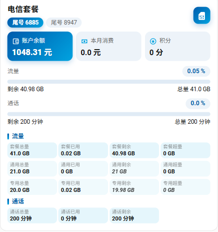

# CTM 电信套餐卡片（多账号）



一个 Home Assistant 自定义卡片，展示中国电信套餐的余额、流量、通话，**一张卡片可放多个号码**，点账号标签即切换。

## 特性

- **多号码切换**：账号胶囊标签，点击切换；注册表缓存，切换几乎零等待
- **余额主卡**：低于阈值自动变红并显示「余额不足」徽标
- **流量明细三行**：套餐 / 通用 / 专用，每行「总量 · 已用 · 剩余 · 超量」四格
- **缺失指标自动推算**：剩余 = 总量 − 已用；超量 = max(0, 已用 − 总量)，推算值用斜体淡色区分真实读数
- **流量 / 通话进度条**：正常蓝、接近阈值橙、超标红，带百分比徽标
- **可视化编辑器**：界面里多选电信设备，不必手写 YAML

## 依赖

- Home Assistant ≥ 2024.1
- `china_telecom` 集成（HACS 安装），它为每个电信号码创建一个设备，本卡片按设备取实体

## 安装

### 方式一：HACS 自定义仓库（推荐）

1. HACS → 前端 → 右上角 ⋮ → 自定义存储库
2. 填入存放本目录的仓库地址，类别选「Dashboard」
3. 搜索安装，刷新页面

### 方式二：手动安装

1. 把 `ctm-telecom-accounts-card.js` 复制到 `/config/www/community/ctm-telecom-accounts/`
2. 设置 → 仪表盘 → 右上角 ⋮ → 资源 → 添加资源
   - URL：`/local/community/ctm-telecom-accounts/ctm-telecom-accounts-card.js`
   - 类型：JavaScript 模块
3. 强制刷新浏览器（Ctrl / Cmd + Shift + R）

## 配置

```yaml
type: custom:ctm-telecom-accounts-card
title: 电信套餐
devices:
  - device_id: "11111111111111111111111111111111"   # 换成你的设备 ID
    name: 尾号 0001
  - device_id: "22222222222222222222222222222222"
    name: 尾号 0002
balance_warning_below: 20
usage_warning_percent: 80
usage_danger_percent: 95
show_all_entities: false
```

| 字段 | 类型 | 默认 | 说明 |
| --- | --- | --- | --- |
| `type` | string | 必填 | `custom:ctm-telecom-accounts-card` |
| `title` | string | 电信套餐 | 卡片标题 |
| `devices` | list | — | 账号列表，每项 `device_id`（必填）+ `name`（可选，标签显示名）；只有 1 个时不显示标签 |
| `device_id` | string | — | 单账号旧写法，`devices` 为空时生效 |
| `balance_warning_below` | number | 20 | 余额低于此值变红（元） |
| `usage_warning_percent` | number | 80 | 流量 / 通话使用率提醒阈值 |
| `usage_danger_percent` | number | 95 | 使用率危险阈值 |
| `show_all_entities` | boolean | false | 追加显示其余未归类实体 |

### 怎么找 device_id

设置 → 设备与服务 → 找到电信套餐设备（一般叫「xxx 套餐信息」）→ 进入详情，地址栏 `/config/devices/device/` 后那串就是。

也可以在卡片编辑器里直接多选设备，不必手填。

## 数据识别规则

卡片不绑定固定实体名，按关键词匹配 `entity_id` / `friendly_name`：

- 余额：`账户余额` / `zhang_hu_yu_e`
- 本月消费：`本月消费` / `ben_yue_xiao_fei`
- 积分：`积分` / `ji_fen`
- 流量：`liu_liang_zong_liang` / `_yi_yong` / `_sheng_yu` / `_chao_liang`
  - 通用流量：`tong_yong_liu_liang_*`
  - 专用流量：`zhuan_yong_liu_liang_*`
- 通话：`tong_hua_zong_liang` / `_yi_yong` / `_sheng_yu`

因此集成不同版本的命名差异多数也能兼容；某项不显示时，先看实体名是否含上述关键词。

## 常见问题

- **显示「未找到可显示实体」**：`device_id` 填错，或该设备下实体被禁用 / 隐藏
- **明细里是斜体数字**：该项传感器集成未提供，卡片按同类指标推算，并非错误值
- **更新后样式没变**：给资源 URL 加 `?v=2` 之类后缀破缓存，或清浏览器缓存

## 许可

MIT
